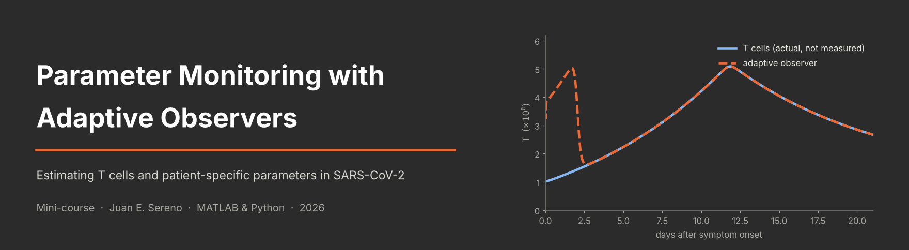
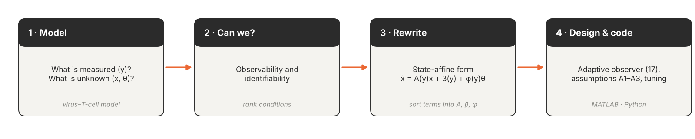
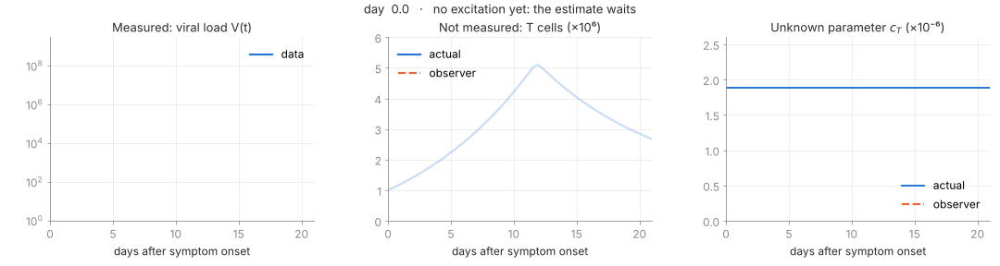
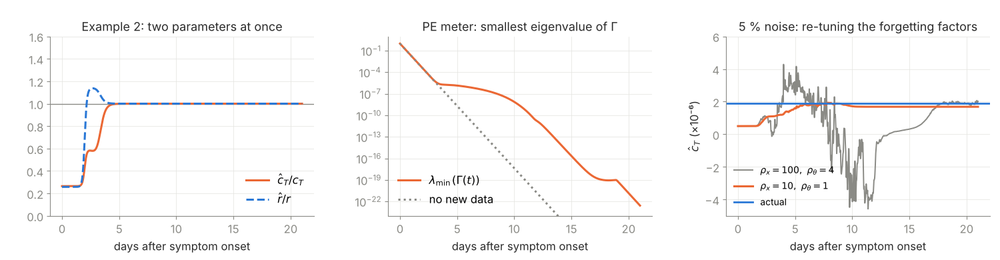

<p align="center">
  
</p>

<p align="center">
  
  
  
  
</p>

<p align="center">
  <b>Lecture slides, step-by-step code and exercises</b><br>
  <a href="#1-slides-from-the-model-to-the-observer">Slides</a> &nbsp;·&nbsp;
  <a href="#2-code-matlab-python-and-notebooks">Code</a> &nbsp;·&nbsp;
  <a href="#3-exercises-and-open-projects">Exercises &amp; projects</a> &nbsp;·&nbsp;
  <a href="#getting-started">Getting started</a>
</p>

Mathematical models in biology and medicine are usually calibrated once, offline, and then
used as if their parameters never changed. Many key quantities, however, cannot be measured
directly and differ from patient to patient. This mini-course shows how an **adaptive
observer** estimates unmeasured states and unknown parameters **at the same time, while the
data arrive**, the core of a medical *digital twin*.

We work with an in-host model of SARS-CoV-2 with a CD8⁺ T-cell response. From the viral load
alone, the observer recovers the **T cells** and the **patient-specific parameters**. The
course is written for undergraduate students: what conditions the system must fulfil, and
how to design and code the observer in MATLAB or Python, one line at a time.

<p align="center">
  
</p>

| | Part | Material | Hands-on |
|:-:|---|---|---|
| **1** | [From the model to the observer](slides) | [Slides (PDF)](slides/MiniCurso_AdaptiveObservers.pdf) · 26 pages | source [`.tex`](slides/MiniCurso_AdaptiveObservers.tex), figure script |
| **2** | [Code](matlab) | [MATLAB](matlab) · [Python](python) · [notebooks](python/ex1_cT.ipynb) | Example 1 ($c_T$) and Example 2 ($c_T$, $r$) |
| **3** | [Exercises and open projects](exercises) | [5 exercises](exercises/README.md#hands-on-exercises) | [PAE / thesis projects](exercises/README.md#open-projects-pae--undergrad-thesis--master-thesis) |

---

## 1. Slides: from the model to the observer

<p align="center">
  <a href=".github/readme/observer_still.png">
    
  </a>
</p>
<p align="center"><sub>Example 1. Only the viral load is measured. For the first two days the virus is too low to excite the system, so the estimate waits; then c<sub>T</sub> converges by day 4 and the T cells are reconstructed.</sub></p>

**[Parameter Monitoring with Adaptive Observers](slides/MiniCurso_AdaptiveObservers.pdf)**
&nbsp;·&nbsp; The course follows a four-step recipe.

1. **Model.** The virus–T-cell model of Hernandez-Vargas & Velasco-Hernandez (2020): what is measured, what is unknown.
2. **Can we?** Observability (T cells can be reconstructed while $V \neq 0$) and identifiability.
3. **Rewrite.** A change of coordinates $x_1 = V/\lambda$, $x_2 = \dot V/\lambda$ removes $T$ from the equations. Each term is then sorted into the state-affine form $\dot x = A(y)x + \beta(y) + \varphi(y)\theta$, using only measured data.
4. **Design and code.** The adaptive observer, its assumptions A1–A3 and how to tune it. Persistent excitation is stated as a condition on the **minimal eigenvalue** of the information matrix $\Gamma$ (as in Aranovskiy et al., 2017), which gives an online *PE meter*.

The deck closes with results, the effect of noise and sparse data, exercises and two open projects.

## 2. Code: MATLAB, Python and notebooks

The code is written to be **read, not to be fast**. Every step is labelled, every matrix
is written out and the state vector is unpacked by index, so each line can be matched to an
equation of the slides. MATLAB and Python give the same numbers.

| | Unknown | State-affine form | Converges by |
|---|---|---|---|
| **Example 1** | $\theta = \gamma = c_T S_T$ (then $\hat c_T = \hat\gamma / S_T$) | $\varphi = [0;\ -y_1]$ | ~ day 4 |
| **Example 2** | $\theta = [\gamma,\ r]$ | the $r$-terms move from $A$ into $\varphi$ | ~ day 6 |

Both examples reconstruct the T cells from $c_T T = \alpha - \sigma V - \dot V / V$ and plot the
PE meter $\lambda_{\min}(\Gamma(t))$. Switches for noise, tuning and initial guesses are at
the top of each script.

- **[MATLAB](matlab)**: `Ex1_main_cT.m`, `Ex2_main_cT_r.m` (run these) plus the observer functions and `patient_model.m`.
- **[Python](python)**: `ex1_cT.py`, `ex2_cT_r.py`, and executed notebooks [`ex1_cT.ipynb`](python/ex1_cT.ipynb), [`ex2_cT_r.ipynb`](python/ex2_cT_r.ipynb) with saved plots.

## 3. Exercises and open projects

The [exercises](exercises/README.md) change the patient, the initial guesses, the noise and
the starting day, and finally ask you to design an observer for a new parameter ($\delta_T$).

The course ends with two **open projects** for a PAE, an undergraduate thesis or a master
thesis: tracking the circadian insulin sensitivity in type 1 diabetes, and monitoring the
menstrual cycle in women with diabetes.

<p align="center">
  
</p>

---

## Repository layout

```text
.
├── slides/
│   ├── MiniCurso_AdaptiveObservers.tex / .pdf   slides (Beamer, metropolis theme)
│   ├── figures/                                 figures used by the slides
│   └── make_figures.py                          regenerates the figures from python/
├── matlab/
│   ├── Ex1_main_cT.m, Ex1_AdapObs_cT.m          Example 1: estimate c_T
│   ├── Ex2_main_cT_r.m, Ex2_AdapObs_cT_r.m      Example 2: estimate c_T and r
│   └── patient_model.m                          in-host model, Eqs. (1)-(2)
├── python/
│   ├── ex1_cT.py, ex2_cT_r.py                   the same examples in Python
│   ├── ex1_cT.ipynb, ex2_cT_r.ipynb             executed notebook versions
│   ├── make_notebooks.py                        rebuilds the notebooks from the scripts
│   └── requirements.txt
├── exercises/
│   └── README.md                                exercises and open projects
└── .github/readme/                              README figures and their generator scripts
```

## Getting started

**Read the slides.** [`slides/MiniCurso_AdaptiveObservers.pdf`](slides/MiniCurso_AdaptiveObservers.pdf).

**Run in MATLAB** (R2016b or newer):

```matlab
cd matlab
Ex1_main_cT      % Example 1
Ex2_main_cT_r    % Example 2
```

**Run in Python** (3.9+):

```sh
cd python
python -m pip install -r requirements.txt
python ex1_cT.py
python ex2_cT_r.py
# or open the notebooks
python -m jupyter lab ex1_cT.ipynb
```

Each example runs in a few seconds on a laptop.

**Rebuild the slides.** From `slides/`, run `python make_figures.py` and then
`latexmk -pdf MiniCurso_AdaptiveObservers.tex`. This needs a TeX distribution with Beamer,
the metropolis theme, TikZ and `listings`.

**Rebuild the README figures.** `python .github/readme/generator/make_all.py`.

## Main references

- A. Rodríguez-Liñán, J. E. Sereno, G. Quiroz-Compean, E. A. Hernandez-Vargas. *Adaptive observers for calibrating immune digital twins in viral infections.* IEEE CDC, 2025.
- E. A. Hernandez-Vargas, J. X. Velasco-Hernandez. *In-host mathematical modelling of COVID-19 in humans.* Annual Reviews in Control 50:448–456, 2020.
- Q. Zhang. *Adaptive observer for multiple-input-multiple-output (MIMO) linear time-varying systems.* IEEE TAC 47(3):525–529, 2002.
- S. Aranovskiy, A. Bobtsov, R. Ortega, A. Pyrkin. *Performance enhancement of parameter estimators via dynamic regressor extension and mixing.* IEEE TAC 62(7):3546–3550, 2017.

The full list is on the last slides.

## Author

**Juan E. Sereno**, Postdoctoral Researcher, University of Dubrovnik.
